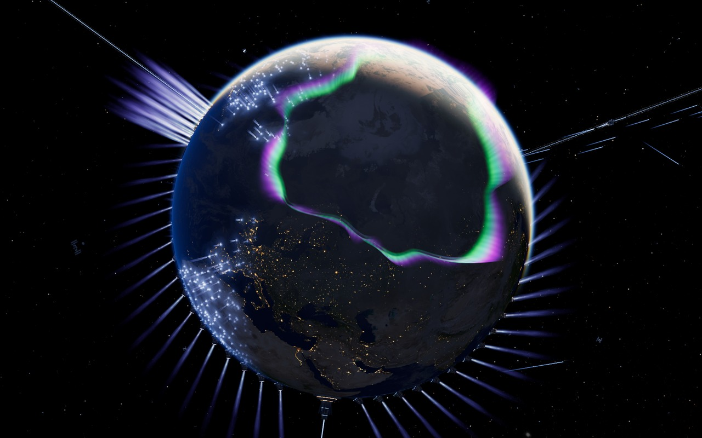

# SKC Earth Odyssey · 地球远航



**带上我们的家，驶向无限。 / One home. Infinite beyond.**

一个可独立运行的双语实时 3D 宇宙空间：从地球、高纬绿紫极光与行星发动机，驶向星系。此仓库是 **V3.1** 已发布体验的独立快照，包含电影旅程、自由探索和经典「起源篇章」。

A standalone bilingual, real-time 3D voyage from Earth and its green-violet polar curtains to the stars. This is an independent snapshot of the published **V3.1** experience, with the cinematic voyage, free exploration and the classic **Origin** edition.

[线上体验 / Live voyage](https://simonseow.com/migration/) · [作者主宇宙 / SKC Universe](https://simonseow.com/) · [来源与鸣谢 / Credits](migration/CREDITS.md)

## 本地运行 / Run locally

需要 Node.js 20 或以上。下载或克隆本仓库后，在仓库根目录运行：

With Node.js 20 or newer, download or clone this repository, then run from its root:

```sh
git clone https://github.com/skc2750/skc-earth-odyssey.git
cd skc-earth-odyssey
npm start
```

打开 **http://127.0.0.1:4320/**。默认只监听本机，不需要安装依赖、注册账号、API key 或付费工具。停止服务请在终端按 `Ctrl+C`。请通过 HTTP 打开；直接双击 HTML 的 `file://` 不支持模块与模型加载。

Open **http://127.0.0.1:4320/**. The server binds only to your computer's loopback interface. No dependency installation, account, API key or paid tool is required. Press `Ctrl+C` in the terminal to stop. Use HTTP rather than opening HTML through `file://`.

```sh
# Optional alternate port / 可选端口
npm start -- --port=4321

# Verify the published snapshot and package boundaries / 验证快照与包装边界
npm run verify
```

## 体验内容 / Experience

- **实时极光 / Live aurora** — 宽软绿青光幕与紫色上褶，保留地球遮挡和昼夜衰减。 / Broad green-cyan curtains with violet folds, Earth occlusion and day/night attenuation.
- **清楚的地球 / Earth detail** — 日间地表、云层、暗侧地形与城市层次；保留故事的冰冻与新太阳转场。 / Terrain, cloud and city detail, retaining the story's ice and new-sun transitions.
- **电影与自由探索 / Film and free flight** — 174 秒电影旅程，或自行拖动、缩放并选择目的地。 / A 174-second cinematic journey, or drag, zoom and choose destinations yourself.
- **双语与画质 / Language and quality** — 浏览器语言自动选择中英，可手动切换；低、中、高画质和电影/中性调色。 / Automatic English/Chinese selection, manual switching, quality tiers and cinematic/neutral grading.
- **设备偏好 / Device preferences** — 手机适配、减少动态偏好、后台暂停和无 WebGL 后备画面。音乐在入场点击后启用。 / Mobile layout, reduced motion, background suspension and a no-WebGL fallback. Sound starts after an entry gesture.

## 项目结构 / Layout

```text
index.html                   Independent bilingual entry
migration/                   Exact 112-file V3.1 published experience
  index.html                 Main voyage
  classic.html               The Origin
  credits.html               Visitor-facing credits
assets/skc-logo.png           Shared favicon
dimension/  mechanics/       Links back to those live SKC spaces
scripts/start.cjs            Zero-dependency loopback HTTP server
scripts/verify.cjs           Integrity and package-boundary verifier
snapshot-manifest.json       SHA-256 and byte counts for 112 + 1 files
docs/SNAPSHOT.md             Snapshot provenance and scope
licenses/                    Supplemental complete vendor notices
```

`dimension/` 和 `mechanics/` 只提供跳转入口，内容保留在作者原网站。`migration/` 内的相对路径、canonical 与生产域名元数据保持已发布版本原样。原上游 README 的截图链接属于原文档，未额外打包截图目录。

The dimension/mechanics folders contain only redirect stubs; their content stays on the author's existing site. Published relative paths, canonical URLs and production-domain metadata inside `migration/` are retained. Screenshot links in the original upstream README are part of the retained documentation; that upstream screenshot directory is not added.

## 静态托管 / Static hosting

把**仓库根目录**作为静态站点根目录，保持目录结构即可。不需要构建步骤或服务端依赖；托管平台应正确提供 JavaScript、WASM、GLB/BIN 和 WOFF2 MIME 类型。不要把 `migration/` 内容平铺到根目录。

Serve the **repository root** as the static document root, preserving the folder structure. No build step or application backend is required. The host must serve JavaScript, WASM, GLB/BIN and WOFF2 with their proper MIME types. Do not flatten `migration/` into the root.

本仓库未配置自动部署、GitHub Actions、生产账号、域名绑定或费用工具。上传仓库不会改动 `simonseow.com` 的当前部署。独立托管前可按需要在你自己的衍生版本中调整元数据；本快照的已发布运行文件刻意保持原字节。

No auto-deployment, GitHub Actions, production account or domain binding is configured. Uploading this repository does not change the existing `simonseow.com` deployment. If making your own derivative deployment, review its metadata separately; the runtime files in this snapshot intentionally retain their published bytes.

## 权利与来源 / Rights and attribution

这是 SKC 对 [earth-migration by 玛卡巴卡 / oxomkbk](https://github.com/oxomkbk/earth-migration) 的独立改编呈现，**不是上游官方版本**。完整上游 MIT、Three.js、字体 OFL、Draco Apache 2.0、fflate MIT、纹理与素材来源均已保留或补齐。上传到仓库不额外授予 SKC 独立贡献或包装的许可证。

This is a modified SKC presentation of earth-migration, **not an official upstream release**. Upstream and vendor licenses, font notices and asset attributions are retained. Repository distribution does not itself grant an additional license to the independent SKC contributions or packaging.

See [LICENSING.md](LICENSING.md), [THIRD_PARTY_NOTICES.md](THIRD_PARTY_NOTICES.md) and [the maintained attribution record](migration/CREDITS.md). This is an artistic cinematic experience; planetary scales, propulsion, travel and night lighting are not a calibrated scientific simulation.
